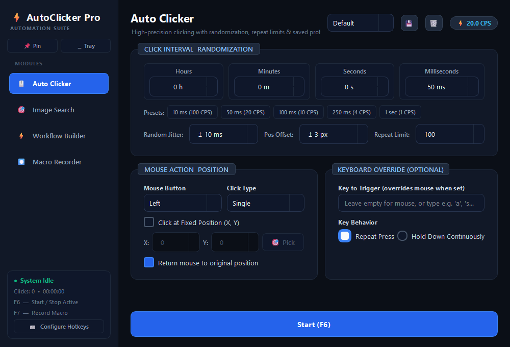
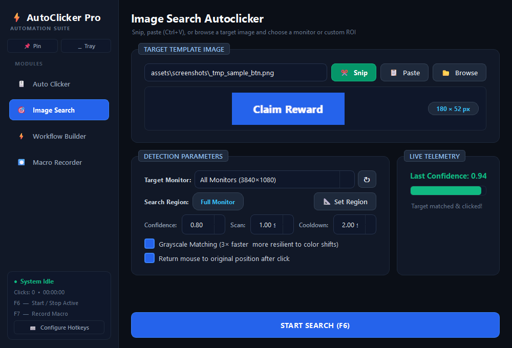
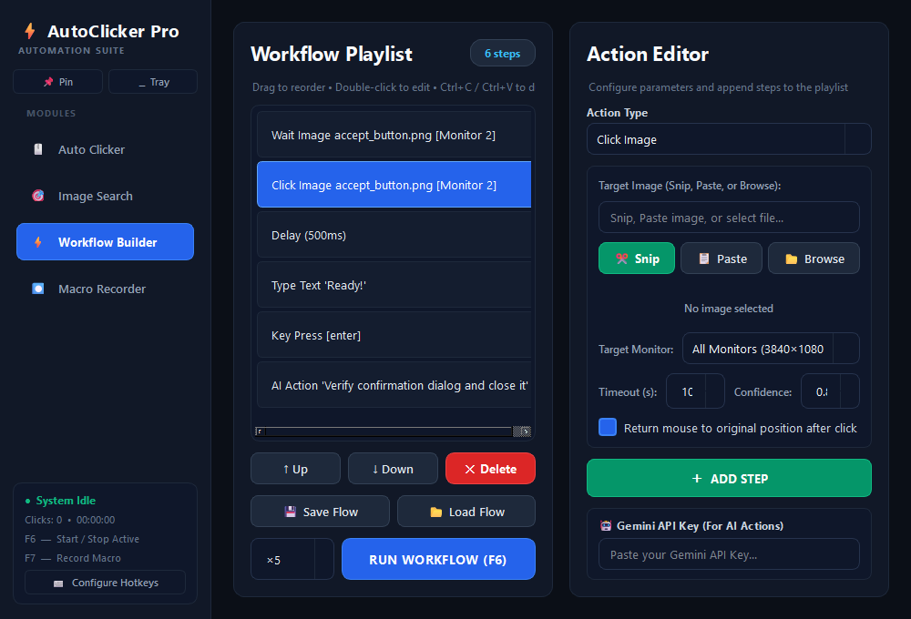
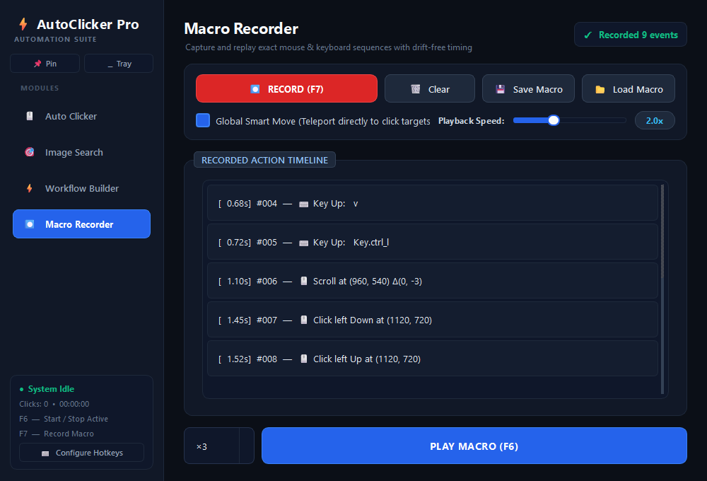
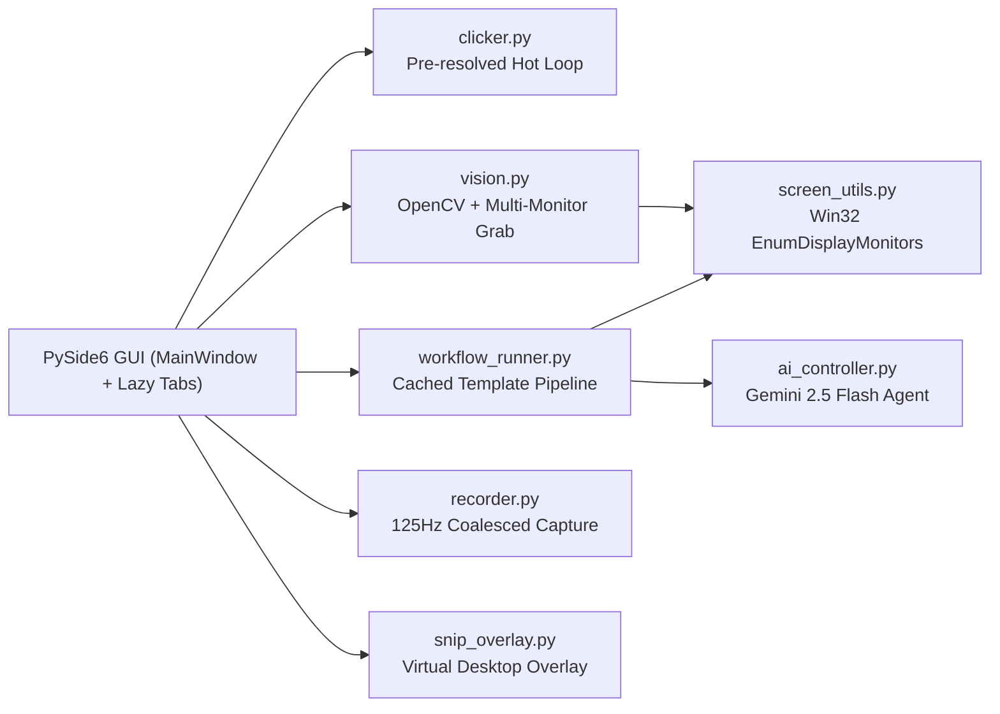

<div align="center">

# ⚡ AutoClicker Pro

### High-Performance Desktop Automation Suite for Windows

**Precision Auto-Clicking • Multi-Monitor Computer Vision • Visual Workflow Builder • Drift-Free Macro Recorder • Gemini AI Agent**

[](https://www.python.org/)
[-41CD52?style=for-the-badge&logo=qt&logoColor=white)](https://doc.qt.io/qtforpython-6/)
[](https://opencv.org/)
[](https://ai.google.dev/)
[](#testing)
[](https://github.com/Westeru/AutoClicker-Pro/releases/latest)
[](LICENSE)

<br />



</div>

---

## ✨ Highlights

AutoClicker Pro is a modern, dark-themed Windows automation suite engineered for **speed**, **accuracy**, and **zero-friction workflows**. Built with **PySide6 (Qt6)**, **OpenCV**, **pynput**, and **Google Gemini Vision**, it combines four specialized automation engines inside one lightweight desktop app.

| Module | What It Does | Key Capabilities |
| :--- | :--- | :--- |
| 🖱️ **Auto Clicker** | Ultra-fast mouse & keyboard automation | Pre-resolved hot loop, `1ms` adaptive precision, **Quick CPS Presets** (`100 CPS` to `1 CPS`), live CPS badge, Keyboard **Repeat Press** & **Hold Down** modes |
| 🎯 **Image Search** | Visual template detection & auto-clicking | **Multi-monitor selector** (any display or full virtual desktop), built-in **✂️ Screen Snip overlay**, direct **`Ctrl+V` clipboard paste**, live confidence meter, **auto-return mouse cursor** |
| ⚡ **Workflow Builder** | Visual multi-step automation playlists | Drag-and-drop reordering, `Delay`, `Click`, `Key Press`, `Type Text`, `Wait Image`, `Click Image`, and **🤖 Gemini AI Agent** steps; save/load JSON flows |
| ⏺️ **Macro Recorder** | Exact input capture & replay | **125Hz move coalescing** (no 1000Hz mouse bloat), **drift-free wall-clock playback** (`0.5×–5.0×`), **Global Smart Move**, JSON export/import |

---

## 🖼️ Interface Showcase

<table>
  <tr>
    <td width="50%" align="center">
      <b>🖱️ High-Speed Auto Clicker</b><br />
      <sub>Quick CPS presets, live rate badge, mouse & keyboard override</sub><br /><br />
      
    </td>
    <td width="50%" align="center">
      <b>🎯 Multi-Monitor Image Search</b><br />
      <sub>Built-in screen snip, Ctrl+V paste, monitor selector & live telemetry</sub><br /><br />
      
    </td>
  </tr>
  <tr>
    <td width="50%" align="center">
      <b>⚡ Visual Workflow Builder</b><br />
      <sub>Drag-and-drop playlists, per-step monitor targeting & Gemini AI actions</sub><br /><br />
      
    </td>
    <td width="50%" align="center">
      <b>⏺️ Drift-Free Macro Recorder</b><br />
      <sub>Timeline log, variable playback speed & Global Smart Move</sub><br /><br />
      
    </td>
  </tr>
</table>

---

## 🚀 Feature Deep Dive

### 🖱️ High-Speed Auto Clicker
- **Sub-10ms Adaptive Timing**: Configure intervals down to **1 ms** (`Hours / Minutes / Seconds / Milliseconds`) or click a one-tap **Quick Preset** (`10 ms • 100 CPS`, `50 ms • 20 CPS`, `100 ms • 10 CPS`, `250 ms • 4 CPS`, `1 sec`).
- **Pre-Resolved Hot Loop**: Button, click count, and key resolution happen once before the loop starts—zero per-click dictionary or reflection overhead.
- **Keyboard Override**: Automate any key (`a`, `space`, `enter`, etc.) in either **Repeat Press** or **Hold Down Continuously** mode.

### 🎯 Multi-Monitor Image Search & Snip/Paste
- **Built-in Multi-Monitor Snipping Tool (`✂️ Snip`)**: Captures a crisp frozen overlay spanning **all connected monitors** with live `W × H px` dimensions—drag to select a target and it loads immediately.
- **Instant Clipboard Paste (`📋 Paste` / `Ctrl+V`)**: Take a snip with Windows Snipping Tool (`Win+Shift+S`) and press `Ctrl+V` directly inside the app—no manual file saving required.
- **Per-Monitor Targeting**: Select **All Monitors** or any specific physical monitor (automatically detects display names, resolutions, and exact Win32 physical coordinates/offsets).
- **Auto-Return Cursor**: Saves your cursor position before clicking a matched image and snaps it right back so your workflow isn't interrupted.
- **Live Telemetry**: Real-time confidence score and color-coded progress bar (`QProgressBar`) against your threshold.

### ⚡ Visual Workflow Builder & AI Agent
- Chain together **`Delay`**, **`Click`** (with 3-second position picker), **`Key Press`** (`ctrl+c`, `win+r`, etc.), **`Type Text`**, **`Wait Image`**, **`Click Image`** (with per-step monitor & cursor return), and **`AI Action`**.
- **🤖 Autonomous AI Action (Gemini 2.5 Flash)**: Describe a goal in plain English (e.g., *"Open Notepad and type Hello"*), and the AI controller analyzes screenshots step-by-step to execute clicks, typing, and key presses autonomously.
- **Full Playlist Control**: Drag-and-drop reordering, `Ctrl+C` / `Ctrl+V` step duplication, double-click editing, live step highlighting during execution, and JSON save/load.

### ⏺️ Drift-Free Macro Recorder
- **1000Hz Mouse Coalescing**: Automatically coalesces sub-8ms mouse move bursts (`>125Hz`) in-place, cutting memory and file bloat by ~90% without losing precision.
- **Wall-Clock Synchronized Replay**: Uses `time.perf_counter()` scheduling instead of cumulative `time.sleep()` delays, eliminating Windows timer-resolution drift at any speed (`0.5×` to `5.0×`).
- **Global Smart Move**: Optional mode that skips intermediate mouse paths and teleports directly to click/scroll coordinates.

---

## ⌨️ Global Hotkeys

| Hotkey | Action |
| :---: | :--- |
| **`F6`** | **Start / Stop** the currently active tab (also acts as the global Panic Button) |
| **`F7`** | **Start / Stop Recording** in the Macro Recorder tab |
| **`Ctrl + V`** | **Paste Image** directly from clipboard in Image Search |
| **`Esc`** | Cancel screen snipping overlay |

---

## 🏗️ Architecture



### Performance Engineering
- **Lazy Tab Instantiation**: Heavy modules (`cv2`, `numpy`, `pyautogui`) are only loaded when secondary tabs are opened, keeping startup instantaneous.
- **Zero Artificial PyAutoGUI Lag**: `pyautogui.PAUSE = 0.0` removes the default 100ms freeze on every automated click/move.
- **In-Memory Template Cache**: `WorkflowRunner` caches OpenCV templates in RAM instead of re-reading from disk on every polling cycle.
- **Non-Blocking Qt Architecture**: All automation engines run on dedicated `QThread` workers with Qt Signal/Slot UI updates and clean shutdown synchronization.

---

## 📦 Getting Started

### Option 1 — Prebuilt Windows Executables (No Python Required)
Download the latest build from [**GitHub Releases**](https://github.com/Westeru/AutoClicker-Pro/releases/latest):
1. **Instant Start (Recommended)**: Download `AutoClickerPro-InstantStart-win64.zip`, extract, and run `AutoClickerPro.exe` (`< 0.5s` cold start)
2. **Standalone Portable**: Download and run `AutoClickerPro-Portable.exe` (single self-contained `.exe`)

### Option 2 — Run from Source
```bash
git clone https://github.com/Westeru/AutoClicker-Pro.git
cd AutoClicker-Pro
pip install -r requirements.txt
python src/main.py
```
*(Or double-click `run.bat` on Windows.)*

---

## 🛠️ Building & Testing

### Testing
The project includes **42 automated unit & GUI tests** (`pytest` + `pytest-qt`):
```bash
pytest -v
```

### Building Executables
Run the automated build script (runs the full test suite first, cleans cache, and compiles both `--onedir` and `--onefile` executables via `AutoClickerPro.spec`):
```bash
python build_exe.py
```
*(Or double-click `build.bat`.)*

---

## 📁 Project Structure

```text
AutoClicker-Pro/
├── assets/screenshots/       # Showcase screenshots for documentation
├── src/
│   ├── main.py               # Application entry point & QSS loader
│   ├── clicker.py            # High-speed mouse & keyboard clicker engine
│   ├── vision.py             # Multi-monitor OpenCV template matching engine
│   ├── workflow_runner.py    # Sequential workflow runner with template cache
│   ├── recorder.py           # Coalesced mouse & keyboard macro recorder
│   ├── ai_controller.py      # Autonomous Gemini Vision agent controller
│   ├── screen_utils.py       # Win32 monitor enumeration & AppData snip storage
│   ├── styles/
│   │   └── dark_theme.qss    # Modern Slate & Electric Blue Qt stylesheet
│   └── ui/
│       ├── main_window.py    # Main window, sidebar navigation & global hotkeys
│       ├── snip_overlay.py   # Multi-monitor screen snipping overlay widget
│       └── tabs/
│           ├── main_tab.py
│           ├── image_search_tab.py
│           ├── workflow_tab.py
│           └── record_tab.py
├── tests/                    # 42 pytest & pytest-qt unit tests
├── AutoClickerPro.spec       # Optimized PyInstaller build spec
├── build_exe.py              # Automated test + build script
├── build.bat / run.bat       # Windows quick-launch helpers
└── requirements.txt
```

---

## 📄 License

This project is open source and available under the [MIT License](LICENSE).
